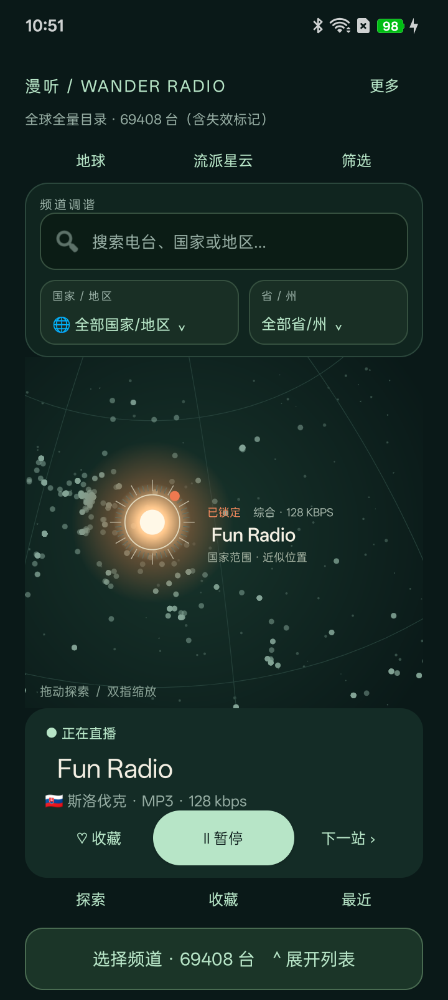
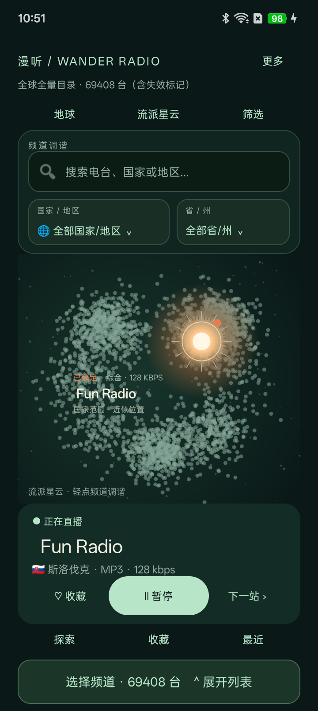
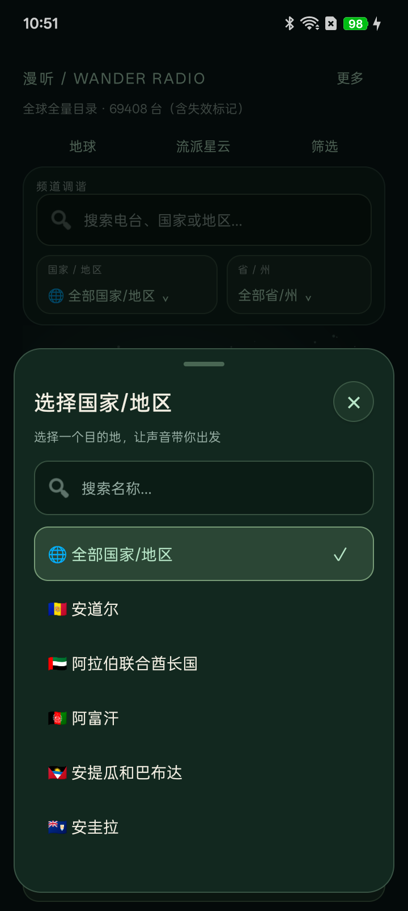
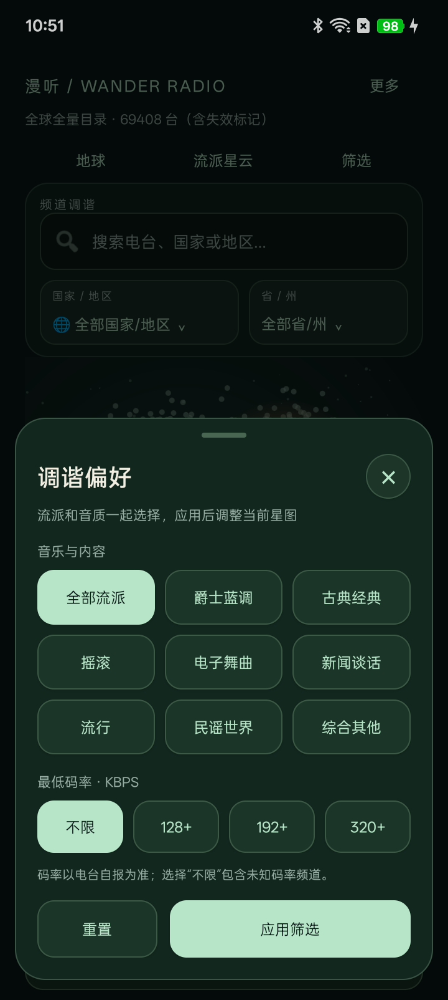
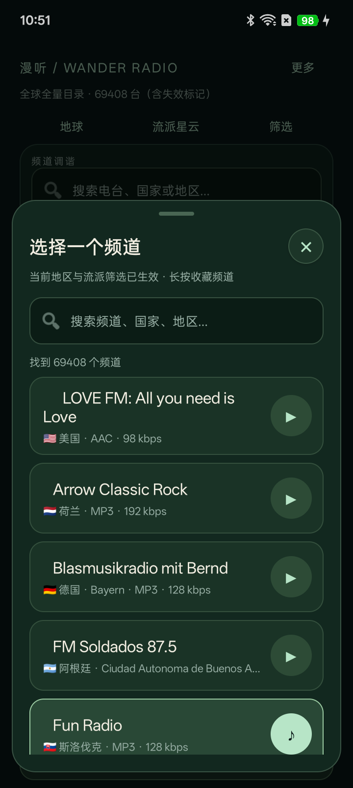
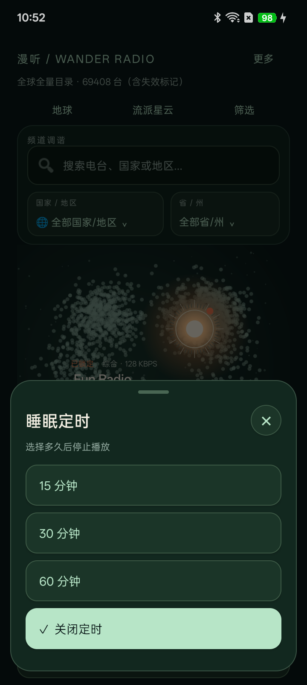

# Wander Radio · 漫听

[简体中文](README.md) | [English](README.en.md)

> Let sound choose your next destination.

Wander Radio is a native Android internet radio client written in Java. Explore live broadcasts from around the world through an interactive globe, a genre nebula, and random station discovery.

Station listings come from [Radio Browser](https://www.radio-browser.info/). Audio streams connect directly to station servers. The interface uses native Android views and Canvas, with AndroidX Media3 ExoPlayer for playback.

**Android 8.0+ · Java 17 · Media3 ExoPlayer · MIT**

[Changelog](CHANGELOG.md) · [Contributing](CONTRIBUTING.md) · [Third-party notices](THIRD_PARTY_NOTICES.md) · [License](LICENSE)

Inspired by [RoamDial](https://roamdial.com/). This is an independent implementation with no affiliation to RoamDial. The supporting documents linked above are currently in Chinese; the app interface is also currently in Chinese.

## Project status

Current version: `0.1.5`. This is an early-stage Android project.

APK builds, Android lint, and core checks for catalogue parsing, search, and cache serialization have passed. MP3/HLS playback, three consecutive pause/resume cycles, and a complete catalogue download were verified on an OPPO PKV110. That catalogue snapshot contained 69,408 stations worldwide, including 2,441 in China, and included stations marked as broken. Counts are not fixed. Lock-screen controls, extended background playback, and manufacturer-specific behavior need further testing.

## Screenshots

These are real v0.1.5 screenshots from an OPPO PKV110. Station names, counts, and playback states reflect the capture session. Approximate country or regional positions are not transmitter locations.

<table>
  <tr>
    <td align="center"><br>Globe and live playback</td>
    <td align="center"><br>Genre nebula</td>
    <td align="center"><br>Countries and regions</td>
  </tr>
  <tr>
    <td align="center"><br>Genre and bitrate filters</td>
    <td align="center"><br>Station browser</td>
    <td align="center"><br>Sleep timer</td>
  </tr>
</table>

## Features

- **Random discovery:** choose another station from the current list, avoiding the current station when alternatives exist.
- **Interactive globe:** drag to rotate, pinch to zoom, and tap station dots to listen. Region selection frames the corresponding station group; station selection smoothly rotates and zooms to its catalogue coordinates or a clearly labeled approximate location.
- **Consistent panels:** rounded dark panels for geography, genre/bitrate, listening tools, sharing, sleep timer, and app information. Genre and bitrate choices are applied together.
- **Tuning interface:** a dark green search panel with a clear button and geographic selectors. Selected stations show a warm glow, dial markings, playback state, name, and bitrate.
- **Genre nebula:** explore broad groups derived from station tags.
- **Cached geography choices:** country and regional indexes are built and sorted in a background thread after catalogue updates. Selectors reuse these indexes; page-progress notifications do not rebuild the map.
- **Countries and regions:** filter by country and then province, state, or region. Search the selector by name. Flags appear in country options, station lists, and player cards.
- **Search and filters:** search station names, countries, country codes, regions, and tags; filter by genre and minimum bitrate.
- **Roomy station browser:** a persistent 50dp launcher opens the list. Explore, Favorites, and Recent also open it directly. Rows are at least 72dp high and clickable across their full width, with search inside the panel.
- **Local favorites:** save stations on the device; long-press a list entry to toggle its favorite state.
- **Recent listening:** retain the last 50 stations.
- **Background playback:** a foreground media service with notification and system media controls.
- **Sleep timer:** pause after 15, 30, or 60 minutes.
- **Sharing:** share the station name, region, and Radio Browser details link through Android.
- **Complete catalogue caching:** load cached listings first, then fetch the global catalogue page by page with progress updates and UUID deduplication. Replace the complete cache only after a successful download. Failed updates retain existing data; tap the status line to retry.
- **Stream fallback:** prefer HTTPS variants of resolved and original URLs, retain original HTTP addresses as fallbacks, and remove duplicate candidates. Failures show HTTP, timeout, DNS, or player errors.

## Architecture

```text
Radio Browser API
        |
        v
StationRepository ---- Local catalogue cache
        |
        v
MainActivity --------- Library
        |              Favorites and recent stations
        +-- AtlasView
        |   Globe projection and genre nebula
        v
RadioService
        +-- Media3 ExoPlayer + HLS
        +-- MediaSession
        +-- Foreground playback notification
        +-- Station audio servers
```

Catalogue requests run off the main thread. Results return to the UI thread. A foreground service manages playback independently of the activity lifecycle and handles audio focus and disconnected headphones.

Radio Browser nodes are discovered through DNS, shuffled, and tried with fallback nodes available. Full catalogue pagination stays on one node and uses name ordering. Offsets advance by the raw response row count, while stations are deduplicated by UUID. A repeated full page stops that node attempt to avoid an infinite loop. Station selection sends the click request specified by Radio Browser's API.

Tuning immediately updates the connection state. The main play button is disabled while connecting or reconnecting. ExoPlayer loads network data asynchronously and is stopped or released on its application main looper. Pausing retains a prepared player and paused notification. Resuming creates a new media session to invalidate callbacks from the previous session. Transient audio-focus loss waits for recovery; user pauses, headphone disconnection, and permanent focus loss do not automatically reclaim playback.

### Technology

| Component | Configuration |
| --- | --- |
| Language | Java 17 |
| UI | Native Android views |
| Visualization | Android Canvas |
| Audio | AndroidX Media3 ExoPlayer 1.8.0 + HLS |
| System media controls | MediaSession, Notification.MediaStyle |
| Network requests | HttpURLConnection |
| JSON | Android's built-in org.json |
| Storage | SharedPreferences and app-private files |
| Build tools | Gradle 8.7, Android Gradle Plugin 8.5.2 |
| Minimum Android version | Android 8.0 / API 26 |
| Compile / target SDK | API 35 |
| Application ID | `com.wanderadio.app` |

Media3 1.8.0 is used with the current compile SDK 35 configuration. Country reference coordinates come from mledoze/countries. See [third-party notices](THIRD_PARTY_NOTICES.md) for attribution and ODbL licensing. Stream and codec support depends on ExoPlayer, device decoders, and the station server.

## Getting started

### Requirements

- Android Studio.
- JDK 17, also selected as Android Studio's Gradle JDK.
- Android SDK Platform 35.
- Android SDK Build-Tools 34.0.0.
- A device or emulator running Android 8.0 or later.

### Run in Android Studio

1. Download or clone the source and choose **Open** in Android Studio.
2. Select the repository root containing `settings.gradle` and `gradlew`.
3. Wait for Gradle synchronization and install missing SDK components if prompted. The first synchronization needs network access for dependencies.
4. Connect a device, enable USB debugging, and approve the computer on the device.
5. Select the `app` run configuration and target device, then click **Run**.

The repository root is the Android project root.

### Build from the command line

macOS / Linux:

```bash
chmod +x gradlew
./gradlew assembleDebug
./gradlew lintDebug
```

Windows:

```powershell
.\gradlew.bat assembleDebug
.\gradlew.bat lintDebug
```

The debug APK is generated at:

```text
app/build/outputs/apk/debug/app-debug.apk
```

Install it on an authorized device:

```bash
adb install -r app/build/outputs/apk/debug/app-debug.apk
```

Debug builds use Android's default debug signing configuration. To use an existing debug keystore:

```bash
./gradlew assembleDebug -PdebugKeystore=/absolute/path/to/debug.keystore
```

This parameter changes only the debug keystore path; the alias and passwords remain Android's debug defaults. Production releases require separate release-signing configuration.

## Project structure

```text
.
├── app/
│   ├── build.gradle
│   └── src/main/
│       ├── AndroidManifest.xml
│       ├── assets/                       # Country reference data and its license
│       ├── java/com/wanderadio/app/
│       │   ├── MainActivity.java         # Screens, search, filters, interactions
│       │   ├── LocationResolver.java     # Station, region, country locations
│       │   ├── GlobeCamera.java          # Projection and camera framing
│       │   ├── AtlasView.java            # Globe and nebula rendering
│       │   ├── RadioService.java         # Playback and media controls
│       │   ├── StationRepository.java    # API nodes, catalogue, cache
│       │   ├── GeographyIndex.java       # Cached geographic choices and lookups
│       │   ├── CataloguePages.java       # Pagination and deduplication
│       │   ├── StreamRoutes.java         # HTTPS preference and fallback routes
│       │   ├── Station.java              # Station data model
│       │   └── Library.java              # Favorites and recent stations
│       └── res/                          # Theme and app icon
├── docs/screenshots/
├── gradle/wrapper/
├── tests/                                # Standalone JVM checks
├── README.md
├── README.en.md
├── CHANGELOG.md
├── CONTRIBUTING.md
├── THIRD_PARTY_NOTICES.md
├── LICENSE
├── build.gradle
├── settings.gradle
├── gradle.properties
├── gradlew
└── gradlew.bat
```

## Validation

Completed checks include:

- Successful `assembleDebug` build.
- `lintDebug` passed with zero errors. Warnings concern dependency version notices, backup configuration, and text internationalization.
- Geography indexes: country/region membership, stable option mapping, immutable snapshots, empty results, and comparison against a 69,408-station cache snapshot.
- Stream routes: HTTPS preference, original URL fallback, deduplication, and HLS metadata persistence.
- Catalogue pagination: raw offsets, UUID deduplication, empty final pages, complete-catalogue parameters, and repeated-page protection.
- Twenty core data checks, including parsing one real 3,000-record response. Nine location fallback checks and seven globe camera checks cover centering, rear-side visibility, the date line, geographic framing, and missing coordinates.

The checks in `tests/` have standalone JVM entry points. They are **not** automatically executed by `./gradlew test`. They require JDK 17, the Android SDK's `android.jar`, and [org.json:json:20240303](https://repo.maven.apache.org/maven2/org/json/json/20240303/) for the desktop JVM. The app itself uses Android's built-in `org.json`.

macOS / Linux:

```bash
export ANDROID_SDK_ROOT=/absolute/path/to/android-sdk
export JSON_JAR=/absolute/path/to/json-20240303.jar

mkdir -p build/core-tests

javac -encoding UTF-8 \
  -cp "$JSON_JAR:$ANDROID_SDK_ROOT/platforms/android-35/android.jar" \
  -d build/core-tests \
  app/src/main/java/com/wanderadio/app/Station.java \
  app/src/main/java/com/wanderadio/app/StationRepository.java \
  app/src/main/java/com/wanderadio/app/CataloguePages.java \
  app/src/main/java/com/wanderadio/app/StreamRoutes.java \
  app/src/main/java/com/wanderadio/app/GeographyIndex.java \
  app/src/main/java/com/wanderadio/app/GlobeCamera.java \
  app/src/main/java/com/wanderadio/app/LocationResolver.java \
  tests/*.java

export TEST_CLASSPATH="build/core-tests:$JSON_JAR:$ANDROID_SDK_ROOT/platforms/android-35/android.jar"
java -cp "$TEST_CLASSPATH" com.wanderadio.app.CoreTest
java -cp "$TEST_CLASSPATH" com.wanderadio.app.GlobeCameraTest
java -cp "$TEST_CLASSPATH" com.wanderadio.app.LocationResolverTest
java -cp "$TEST_CLASSPATH" com.wanderadio.app.StreamRoutesTest
java -cp "$TEST_CLASSPATH" com.wanderadio.app.CataloguePagesTest
java -cp "$TEST_CLASSPATH" com.wanderadio.app.GeographyIndexTest
```

The core suite runs 18 checks without a catalogue file. To run two additional parsing checks with an existing public Radio Browser array response:

```bash
java -cp "$TEST_CLASSPATH" com.wanderadio.app.CoreTest /absolute/path/to/catalog.json
```

Data checks do not replace audio testing. Version 0.1.4 was tested on an OPPO PKV110 for live playback and three consecutive pause/resume cycles. Headphone switching, lock-screen controls, prolonged background playback, and sleep timing need separate acceptance tests.

## Data and privacy

- No app account is required.
- Favorites, recent stations, and catalogue caches stay on the device.
- No advertising SDK or analytics tracking is integrated. Broadcast streams may contain advertisements.
- The app does not request location, microphone, or contacts permissions.
- Station positions come from catalogue data; the app does not read the listener's location.
- Catalogue requests and station clicks go to Radio Browser. Audio requests go to the corresponding station server. These services can see the request IP address and connection information.
- HTTP audio is allowed for compatibility with some stations. Not every stream connection is encrypted.

## Limitations

- The global Radio Browser catalogue is fetched in pages of 5,000 until the final page, with no popular-station cap. Entries marked as broken are retained; entries without an ID or an HTTP/HTTPS stream URL are excluded. Search covers only loaded data until loading completes. Counts change upstream and may differ from other sites' snapshots or filters.
- The globe prefers catalogue coordinates. Missing coordinates fall back to the coordinate group of stations in the same country and region, then to an offline country reference position. Approximate positions are labeled. Stations without usable country information may remain available only through the list.
- Genres are broad classifications derived from community tags.
- Bitrate, codec, and location metadata depend on the catalogue. Unknown bitrates are not estimated.
- Some streams are unavailable, geographically restricted, or use unsupported codecs. A complete directory does not guarantee playback of every station.
- The globe limits simultaneously drawn dots for responsiveness. Lists, geographic filters, and search use all loaded entries.
- Cached listings support offline browsing, not offline audio playback.
- Song recognition, lyrics, audio spectrum visualization, cross-device synchronization, widgets, and radio alarms are not implemented.
- The project does not use RoamDial's private services or promise feature or visual parity with that site.

## Contributing

Issues and pull requests are welcome. See [CONTRIBUTING.md](CONTRIBUTING.md).

For playback reports, include the Android version, device model, station name, reproduction steps, and relevant error messages. Pull requests should describe the change, validation, and any impact on playback or stored-data compatibility.

Do not commit `local.properties`, `.gradle/`, build outputs, personal IDE settings, or signing keys.

## Acknowledgements

- [Radio Browser](https://www.radio-browser.info/) for the community-maintained station directory.
- [Radio Browser API](https://api.radio-browser.info/) for catalogue access and node discovery documentation.
- [RoamDial](https://roamdial.com/) for the inspiration behind random listening and spatial exploration.
- Radio stations and their operators for providing live broadcasts.

Thanks to the [LINUX DO](https://linux.do/) community for its support.

## License

Application code is licensed under the [MIT License](LICENSE). Country reference data remains under ODbL 1.0, and Media3 and other dependencies retain their own licenses. See [third-party notices](THIRD_PARTY_NOTICES.md). The MIT license does not grant rights to broadcasts or third-party datasets.
